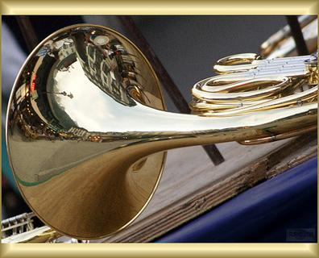
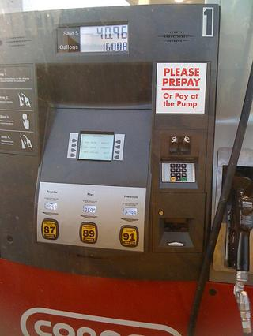

# Três características extras de imagem

Atividade de MLOps. O enunciado pede: além das médias de Luminância, R, G e B, propor 3 características da imagem (numéricas ou categóricas), extrair com ajuda de uma ferramenta de IA e mostrar definição, código, três imagens e resultado.

A ferramenta de IA aqui foi o Claude, que escreveu o código. Eu escolhi as características, revisei o código e rodei nas imagens.

## Por que estas três

O projeto deste repositório já guarda largura, altura, tamanho do arquivo, as médias L/R/G/B, o contraste (desvio-padrão da luminância) e a nitidez (variância do Laplaciano). Quis três coisas que isso não cobre:

1. **Quão colorida** a foto é. Duas fotos podem ter a mesma média de R, G e B e uma ser vibrante e a outra desbotada.
2. **Quanto detalhe** a foto tem. Uma árvore sem folhas e uma parede lisa podem ter o mesmo brilho médio.
3. **Qual cor** domina, dita em palavra. Serve de exemplo de característica categórica, que dá pra contar por classe no tempo.

## As três características

### 1. `colorfulness` (numérica)

Mede o quanto a foto é colorida. Cinza puro dá 0 e quanto mais viva a cor, maior o número.

Usei a fórmula de Hasler e Süsstrunk (2003). Em vez de olhar R, G e B direto, ela olha para duas diferenças que o olho percebe como cor: vermelho contra verde, `rg = R - G`, e amarelo contra azul, `yb = 0.5(R+G) - B`. Depois combina quanto elas variam dentro da foto e quanto a foto inteira pende para um lado:

```
colorfulness = sqrt(std(rg)² + std(yb)²) + 0.3 * sqrt(mean(rg)² + mean(yb)²)
```

### 2. `edge_density` (numérica, de 0 a 1)

É a fração da foto que é borda. Perto de 0 a imagem é lisa, perto de 1 é cheia de contorno.

Converto para tons de cinza e passo o filtro de Sobel, que compara cada pixel com os vizinhos e diz o quanto o brilho muda ali. Um pixel conta como borda se essa mudança passa de 25 níveis de cinza (o limite é um chute razoável meu, não foi calibrado). O resultado é a proporção de pixels de borda.

### 3. `dominant_color` (categórica)

É o nome da cor que mais aparece. RGB é ruim pra dar nome de cor, então converto para HSV (matiz, saturação, brilho) e dou um nome a cada pixel:

| Condição do pixel | Nome |
|---|---|
| brilho < 0,2 | black |
| saturação < 0,2 e brilho > 0,8 | white |
| saturação < 0,2 (ou escuro), fora os casos acima | gray |
| o resto | red, orange, yellow, green, cyan, blue, purple ou pink, pela faixa de matiz |

Vence o nome com mais pixels. Fica um valor de 11 possíveis.

## Código

Arquivo: [scripts/extra_features.py](../scripts/extra_features.py). Só precisa de `numpy` e `Pillow`. Comando:

```bash
python scripts/extra_features.py docs/2026-11-04_features_extras_imagens/img*.jpg
```

Código completo:

```python
"""Tres caracteristicas extras de imagem, alem das medias de L, R, G e B.

O curso extrai so a media de cada canal. Aqui a gente olha para outras tres coisas que uma foto tem:

1. colorfulness    (numero)    quao "viva" e a cor da foto. Cinza puro da 0, foto bem saturada da alto.
2. edge_density    (numero)    quanta parte da foto e borda, ou seja, quanto detalhe ela tem.
3. dominant_color  (categoria) o nome da cor que mais aparece (preto, branco, vermelho, azul...).

Como usar:
    python scripts/extra_features.py foto1.jpg foto2.jpg foto3.jpg

So precisa de numpy e Pillow. Cada funcao recebe a imagem como array RGB de formato (altura, largura, 3).
"""

from __future__ import annotations

import sys
from pathlib import Path

import numpy as np
from PIL import Image

# Um pixel conta como "borda" se a luminosidade muda mais que isso (em niveis de cinza, 0 a 255) entre vizinhos.
# 25 foi um chute razoavel, nao foi calibrado: mais baixo pega ruido e textura leve, mais alto fica so com contorno.
EDGE_THRESHOLD = 25.0

# Faixas de matiz (hue), em graus de 0 a 360 na roda de cores, e o nome de cada uma.
# O vermelho aparece duas vezes porque a roda e um circulo: 0 e 360 sao a mesma cor.
HUE_NAMES: tuple[tuple[str, float], ...] = (
    ("red", 15),
    ("orange", 40),
    ("yellow", 70),
    ("green", 160),
    ("cyan", 200),
    ("blue", 255),
    ("purple", 290),
    ("pink", 345),
    ("red", 360),
)
COLOR_NAMES: tuple[str, ...] = (
    "black", "white", "gray", "red", "orange", "yellow", "green", "cyan", "blue", "purple", "pink",
)


def colorfulness(rgb: np.ndarray) -> float:
    """Mede o quanto a foto e colorida, pela formula de Hasler e Suesstrunk (2003).

    A ideia: em vez de olhar R, G e B direto, a formula olha para duas diferencas que o olho humano
    percebe como cor: vermelho contra verde (rg) e amarelo contra azul (yb). Se a foto e toda cinza,
    essas diferencas sao zero. Quanto mais elas variam e quanto mais puxam para um lado, mais colorida.
    """
    r, g, b = (rgb[..., i].astype(np.float64) for i in range(3))
    rg = r - g
    yb = 0.5 * (r + g) - b
    espalhamento = np.hypot(rg.std(), yb.std())  # o quanto as cores variam dentro da foto
    deslocamento = np.hypot(rg.mean(), yb.mean())  # o quanto a foto toda pende para uma cor
    return float(espalhamento + 0.3 * deslocamento)


def edge_density(rgb: np.ndarray, threshold: float = EDGE_THRESHOLD) -> float:
    """Fracao da foto que e borda, de 0 (tudo liso) a 1 (tudo contorno).

    Passa o filtro de Sobel na imagem em tons de cinza. Esse filtro compara cada pixel com os vizinhos
    e diz quao forte e a mudanca de brilho ali (gx na horizontal, gy na vertical). Depois conta quantos
    pixels passam do limite. O "/ 8" so deixa o resultado na mesma escala dos niveis de cinza.
    """
    cinza = np.asarray(Image.fromarray(rgb).convert("L"), dtype=np.float64)
    if min(cinza.shape) < 3:  # imagem pequena demais para olhar vizinhos
        return 0.0
    gx = (
        cinza[:-2, 2:] + 2 * cinza[1:-1, 2:] + cinza[2:, 2:]
        - cinza[:-2, :-2] - 2 * cinza[1:-1, :-2] - cinza[2:, :-2]
    ) / 8
    gy = (
        cinza[2:, :-2] + 2 * cinza[2:, 1:-1] + cinza[2:, 2:]
        - cinza[:-2, :-2] - 2 * cinza[:-2, 1:-1] - cinza[:-2, 2:]
    ) / 8
    return float((np.hypot(gx, gy) > threshold).mean())


def dominant_color(rgb: np.ndarray) -> str:
    """Nome da cor que mais aparece na foto (uma categoria, nao um numero).

    RGB e ruim para dar nome de cor, entao converte para HSV: matiz (qual cor), saturacao (quao forte)
    e valor (quao claro). Cada pixel recebe um nome:
      - muito escuro (valor < 0,2)                  -> black
      - quase sem cor (saturacao < 0,2) e bem claro -> white
      - quase sem cor e nem claro nem escuro        -> gray
      - o resto                                     -> nome pela faixa de matiz (HUE_NAMES)
    No fim, vence o nome que mais pixels tiveram.
    """
    hsv = np.asarray(Image.fromarray(rgb).convert("HSV"), dtype=np.float64)
    matiz = hsv[..., 0] * 360 / 255  # Pillow guarda o matiz de 0 a 255; aqui vira graus
    saturacao = hsv[..., 1] / 255
    valor = hsv[..., 2] / 255

    indice = {nome: i for i, nome in enumerate(COLOR_NAMES)}
    rotulo = np.empty(matiz.shape, dtype=np.int64)

    sem_cor = (saturacao < 0.2) | (valor < 0.2)
    rotulo[sem_cor] = indice["gray"]
    rotulo[sem_cor & (valor < 0.2)] = indice["black"]
    rotulo[sem_cor & (valor > 0.8)] = indice["white"]

    inicio = 0.0
    for nome, fim in HUE_NAMES:
        rotulo[~sem_cor & (matiz >= inicio) & (matiz < fim)] = indice[nome]
        inicio = fim

    contagem = np.bincount(rotulo.ravel(), minlength=len(COLOR_NAMES))
    return COLOR_NAMES[int(contagem.argmax())]


def extract(path: Path) -> dict[str, object]:
    """Abre a imagem e devolve as tres caracteristicas num dicionario."""
    rgb = np.asarray(Image.open(path).convert("RGB"))
    return {
        "image": path.name,
        "colorfulness": round(colorfulness(rgb), 2),
        "edge_density": round(edge_density(rgb), 4),
        "dominant_color": dominant_color(rgb),
    }


def main(paths: list[str]) -> None:
    for path in paths:
        print(extract(Path(path)))


if __name__ == "__main__":
    main(sys.argv[1:])
```

## As três imagens

Fotos reais do Imagenette (`data/imagenette2-320/val`), de classes diferentes, escolhidas pra dar resultados diferentes.

| 1. Motosserra | 2. Trompa | 3. Bomba de combustível |
|---|---|---|
|  |  |  |

## Resultado

Saída do script nas três imagens:

| Imagem | `colorfulness` | `edge_density` | `dominant_color` |
|---|---|---|---|
| img1_motosserra.jpg | 24.03 | 0.3659 | white |
| img2_trompa.jpg | 39.07 | 0.1534 | orange |
| img3_bomba.jpg | 46.70 | 0.0887 | gray |

O que dá pra ler disso:

1. **Bordas.** A foto da motosserra tem 37% de pixels de borda: galhos finos contra o céu claro. A bomba tem 9%, porque é feita de superfícies grandes e lisas. A trompa fica no meio, com 15%.
2. **Cor dominante.** O céu da primeira foto domina e a cor dela vira "white". Na trompa, o dourado cai na faixa do laranja. Na bomba, o cinza vence com 42% dos pixels, seguido de laranja (30%) e vermelho (16%). O corpo vermelho da máquina cai em boa parte na faixa do laranja, então o nome "red" nem aparece como vencedor.
3. **Colorido.** A bomba (46,7) é mais colorida que a trompa (39,1), mesmo com `dominant_color` "gray" contra "orange". As duas medidas respondem coisas diferentes: uma diz quão forte é a cor no geral, a outra diz qual cor ocupa mais área.

## Limites

1. São só três imagens. Isso mostra o código funcionando, não valida as características.
2. Os limiares (25 para borda, 0,2 e 0,8 para saturação e brilho) não foram calibrados em dados.
3. `dominant_color` perde informação: uma foto metade vermelha e metade azul vira um nome só.
4. Não adicionei estas variáveis ao `features.py` do serviço, que continua com as 9 escalares e os 4 histogramas.
